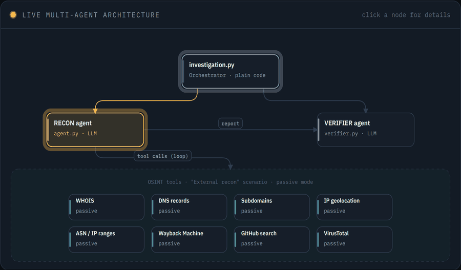
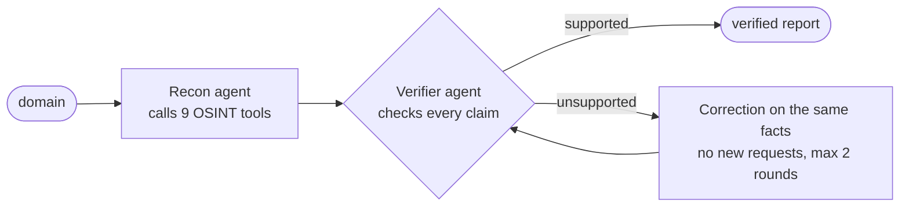
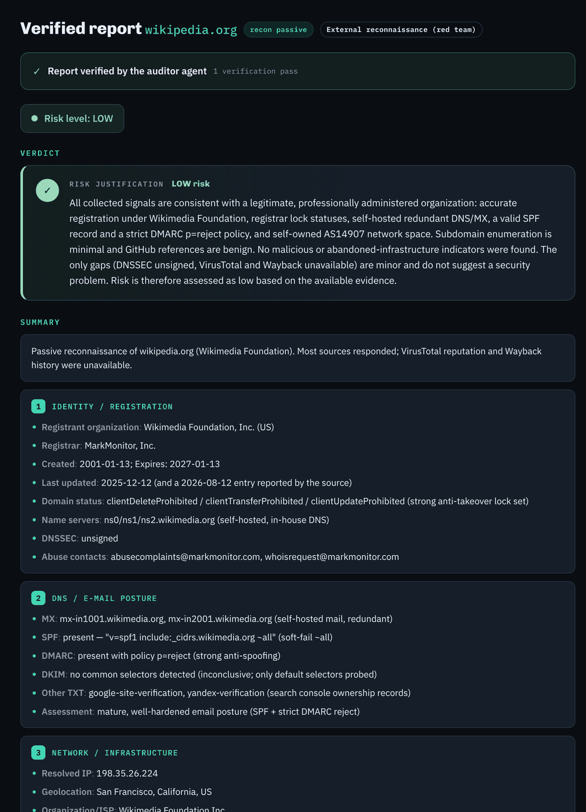

<div align="center">

# osintllm


### An LLM agent that maps a domain's attack surface — and audits its own report before you see it.

<a href="https://lightgray-mole-546786.hostingersite.com/"></a>

<sub>The demo replays real recorded analyses (DeepSeek, passive mode) in the full UI, with evaluation results included.</sub>

</div>

<p align="center">
  
</p>

<p align="center"><sub>Real capture of a live analysis: each tool and agent lights up as it runs.</sub></p>

## Highlights

- **Self-auditing agent** — a second LLM checks every claim against the raw collected data. It has no tool access, so it can verify but never invent.
- **4× fewer hard hallucinations** with the verifier (0.012 → 0.003 on DeepSeek, 45 runs per config — [results](docs/RESULTS.md)).
- **0 / 10 prompt-injection attacks succeed** across 6 attack families ([threat model](docs/THREAT_MODEL.md)).
- **Findings grounded in MITRE ATT&CK** — hybrid retrieval (BM25 + `mistral-embed`, RRF) over the 706 techniques of ATT&CK v20.0: Hit@5 0.603 vs 0.508 dense-only and 0.317 BM25-only on 63 labeled queries; mappings in 95% of agent runs and **0 invented technique ID** in 43 verified reports ([RAG](docs/RAG.md)).
- **9 public OSINT sources**, passive by default — the target is never contacted unless you enable active mode.
- **Live UI** — the agents' reasoning streams to the browser (SSE), and a benchmark tab runs the eval harness on demand.

## What I built

| Area | Details |
|---|---|
| Agent design | Hand-written ReAct tool-calling loop (no framework), recon agent + verifier agent with bounded correction loop |
| Retrieval (RAG) | MITRE ATT&CK index from the official STIX bundle, hybrid BM25 + dense retrieval with RRF, no vector DB or framework, `attack_lookup` tool, deterministic guard on technique IDs |
| Evaluation | Reproducible eval harness (recorded fixtures, fixed seed), hallucination metrics, DeepSeek vs Mistral comparison, adversarial suite, retrieval eval (Recall@k, MRR, two independent labelers) |
| Security | Prompt-injection mitigations (data/instruction separation, allow-list, verifier pass, input caps) |
| Backend | Python 3.12, FastAPI, Server-Sent Events, disk cache + per-host throttling |
| Frontend | React + Vite, animated SVG architecture graph, report export (JSON / Markdown / HTML) |
| Quality | pytest suite, ruff, GitHub Actions CI, declarative YAML scenarios |

## How it works



Details: [docs/ARCHITECTURE.md](docs/ARCHITECTURE.md).

<details>
<summary><b>Sample verified report</b> (wikipedia.org)</summary>



</details>

## Data sources

| Tool | Source | Returns |
|---|---|---|
| `whois_lookup` | WHOIS registries | registrar, dates, name servers |
| `dns_records_lookup` | DNS resolver | MX, TXT, NS + SPF/DMARC posture |
| `enumerate_subdomains` | Certificate Transparency logs | known subdomains |
| `ip_geolocate` | ip-api.com | country, city, ISP |
| `asn_lookup` | bgpview.io + RIPEstat | ASN + IP ranges |
| `wayback_lookup` | web.archive.org | archived infrastructure |
| `tech_fingerprint` | the target (active mode, 1 request) | tech stack + security headers |
| `github_search` | api.github.com | related repos, exposed secrets |
| `virustotal_lookup` | VirusTotal | reputation + passive DNS |
| `attack_lookup` | local MITRE ATT&CK index | techniques matching the findings |

More in [docs/TOOLS.md](docs/TOOLS.md).

## Quick start

```bash
make install && make web-install   # Python 3.12 venv (uv) + frontend deps
cp .env.example .env               # set DEEPSEEK_API_KEY
make serve                         # → http://localhost:8000
```

Web demo: `make demo` builds the same UI as a static site that replays the analyses recorded in `web/public-demo/` (record new ones with `make demo-record`). Upload `web/dist-demo/` to any static host.

CLI: `.venv/bin/python main.py example.com` writes `reports/<domain>.{json,md,html}`. Dev mode, tests and evals: `make help`.

## Documentation

[Architecture](docs/ARCHITECTURE.md) · [ATT&CK retrieval](docs/RAG.md) · [Results](docs/RESULTS.md) · [Eval methodology](docs/EVAL_PLAN.md) · [Threat model](docs/THREAT_MODEL.md) · [Tools](docs/TOOLS.md) · [Configuration](docs/CONFIGURATION.md) · [Design decisions](DECISIONS.md) · [Scenarios](scenarios/README.md) · [Changelog](CHANGELOG.md)

## Responsible use

Built for authorized security assessments, monitoring your own domains, and learning. Respect the queried services' terms and rate limits (built-in cache and throttling help). Only enable active mode on domains you are authorized to test.

## License

[MIT](LICENSE)

<sub>Developed with the help of AI coding assistants (Devin AI and Claude).</sub>
