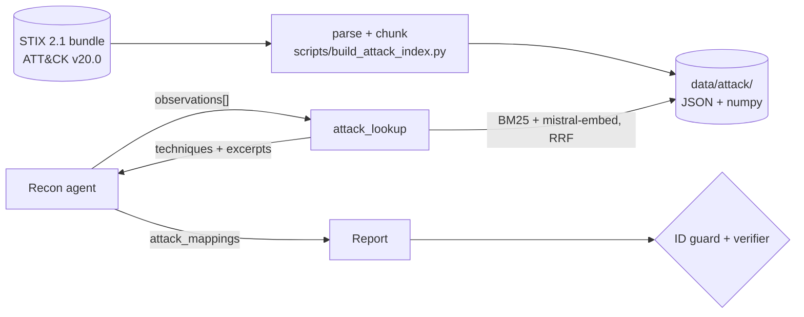

# MITRE ATT&CK retrieval layer (RAG)

The agent can ground its findings in MITRE ATT&CK: it describes what it
observed ("DMARC policy is p=none, SPF ends with ~all"), the `attack_lookup`
tool retrieves the matching techniques from a local index of the official
corpus, and the report maps findings to real technique IDs. Every ID in the
final report has been returned by a retrieval call during the run: a
deterministic guard enforces it.

> Numbers below are measured, never estimated. Raw results:
> [`evals/rag/results/`](../evals/rag/results/). Agent-level results: see
> [Agent-level evaluation](#agent-level-evaluation).

## Pipeline



## Corpus

| | |
|---|---|
| Source | [`mitre-attack/attack-stix-data`](https://github.com/mitre-attack/attack-stix-data), `enterprise-attack-20.0.json` |
| Version | **ATT&CK v20.0** (released 2026-10-13), pinned in `scripts/build_attack_index.py` |
| Integrity | sha256 `81113ba9…5352`, recorded in `data/attack/manifest.json` |
| Kept | `attack-pattern` objects, revoked and deprecated ones skipped: **706 techniques** (227 techniques + 479 sub-techniques) |
| Per technique | ATT&CK ID, name (`Parent: Sub` for sub-techniques), tactics, platforms, URL, description, detection strategies |

**Detection text.** Since ATT&CK v18 the free-text `x_mitre_detection` field
no longer exists (0 techniques carry it in v20.0). Detection now lives in
`x-mitre-detection-strategy` objects linked to a technique by a `detects`
relationship, each pointing to analytics. The index keeps the strategy
**names** only: the analytics describe endpoint telemetry (process lineage,
Windows events), which has nothing to match in passive domain
reconnaissance and would add noise.

**Cleaning.** Citation markers `(Citation: …)`, markdown links (label kept)
and `<code>` tags are stripped.

## Chunking

Descriptions are packed paragraph by paragraph into chunks of at most
**1,200 characters** (~300 tokens); a paragraph longer than that is split on
sentence boundaries. Every chunk starts with a header line, so it stays
self-contained when retrieved alone:

```
T1552.001 Unsecured Credentials: Credentials In Files (tactics: Credential Access)
Adversaries may search local file systems and remote file shares for files …
```

The detection strategies form one extra chunk per technique. Result:
**1,789 chunks**.

## Retrieval

| Component | Choice |
|---|---|
| Dense | `mistral-embed` (1,024 dimensions), cosine similarity on L2-normalized vectors |
| Lexical | Okapi BM25 (k1 = 1.5, b = 0.75), hand-written in [`rag/bm25.py`](../src/osintllm/rag/bm25.py) |
| Fusion | Reciprocal rank fusion, `1 / (60 + rank)` summed over both rankings, top 100 candidates each |
| Unit | Retrieval on chunks; a technique scores as its best chunk, which provides the excerpt |
| Storage | `data/attack/`: `techniques.json`, `chunks.json`, `embeddings.npy` (float16 on disk, 3.5 MB) |

**Why Mistral for embeddings.** DeepSeek's API exposes no embedding model
(checked on its `/models` endpoint), so embeddings come from `mistral-embed`
whatever the chat provider, through the `openai` SDK already in the project
(`/v1/embeddings` is OpenAI-compatible). Building the index cost
**236,922 prompt tokens** (measured at build time, recorded in the manifest).
Query embeddings go through a disk cache.

**Why hybrid.** ATT&CK queries mix exact terms (DMARC, SPF, certificate,
WHOIS) and paraphrase. The eval below shows each method failing where the
other succeeds.

**Without `MISTRAL_API_KEY`** (or if the embedding call fails), the tool
falls back to BM25 alone and says so in its `retrieval` field.

## Integration

**Tool.** [`attack_lookup`](../src/osintllm/tools/attack_lookup_tool.py)
takes a **list** of observations (max 8) and returns, for each, the top-k
techniques (default 5) with ID, name, tactics and a 200-character excerpt.
The URL (derived from the ID) and the retrieval score are left out: the
output is re-sent in every later LLM call of the run, so its size drives the
token overhead (-34% payload, measured below). Five techniques are kept:
on the retrieval eval, a top 3 drops hybrid Hit from 0.603 to 0.508. One batched call keeps the cost at a single step of the agent
loop, whose iteration budget is hard-capped; with the layer on, that budget
gets **two** extra steps: one for the lookup, one because the last step is a
forced report (below). With a single extra step, `mistral-small` spent it
collecting and called `attack_lookup` in only half of the runs (measured,
see [Agent-level evaluation](#agent-level-evaluation)).

**Forced last step.** A model that calls one tool per step can spend the
whole budget collecting and never deliver its report (measured with
`mistral-small`). The last step of the loop therefore forces
`submit_report`, with an instruction to report on the facts collected so
far; such reports are marked `report_forced`. This applies with the layer on
or off.

**No mapping without a lookup.** A forced report, or a revision requested by
the verifier, written before any `attack_lookup` call gets the
`submit_report` schema without `attack_mappings`: measured on a smoke run,
the model otherwise filled it from memory, with invented IDs.

**Replay.** The tool is marked `replayable=False`: it bypasses the fixtures
and the tool cache. Its argument is free text written by the LLM, so a
fixture keyed on the exact arguments would never match from one run to the
next, and its result is already deterministic for a given query (local
index).

**Security.** ATT&CK is a trusted source, yet the tool output goes through
the same delimiting as every other tool result (`_wrap_untrusted`), and
excerpts are capped like other third-party text.

**Report.** `OsintReport.attack_mappings`: a list of
`{finding, technique_id, technique_name, justification}`, rendered in the
Markdown, HTML and JSON exports and in the React report view (links to
`attack.mitre.org` are built only from well-formed IDs). Reports produced
without the layer, archived ones included, simply have an empty list.

**Toggle.** `OSINTLLM_ATTACK_RAG=0` withdraws the tool and leaves the system
prompt, the `submit_report` schema and the verifier prompt byte-identical to
the pre-RAG ones (tested): that is the baseline of the agent-level eval.
Restricted scenarios (`email_security_posture`, `phishing_triage`) do not
list the tool, so the layer stays off for them.

## Verification

Two checks, both feeding the existing correction loop
([`verifier.py`](../src/osintllm/verifier.py)):

1. **Invented IDs, deterministic, zero tolerance.** Every string matching
   `T\d{4}(\.\d{3})?` anywhere in the report (summary, justification,
   recommendations, mappings) is compared with the IDs returned by the
   run's `attack_lookup` calls. Any other ID marks the report unverified and
   is sent back for correction, whatever the LLM audit concluded.
2. **Justification vs retrieved text, LLM audit.** When the report carries
   ATT&CK content, the verifier prompt gains one rule: a mapping whose
   justification contradicts or stretches the retrieved excerpt is flagged
   like any unsupported claim.

**Last line of defense.** If an invented ID survives the correction rounds,
[`investigation.py`](../src/osintllm/investigation.py) drops its mapping and
replaces free-text mentions with a visible `[unverified ATT&CK ID removed]`
marker before the report reaches the user. The removal is counted
(`stripped_attack_ids`) so the eval can report it.

## Retrieval evaluation

### Method

**Observations.** 26 real findings, extracted by deterministic rules from
the recorded tool outputs of the 15 eval domains
([`extract_observations.py`](../evals/rag/extract_observations.py)): weak
SPF/DMARC, recently registered domains, look-alike names, VirusTotal
detections, presence in public blocklists, non-production subdomains in
Certificate Transparency logs, sensitive archived paths, missing security
headers, DNSSEC. No model wrote them, so the queries carry no vocabulary
bias toward the retriever or the labelers. A first attempt had an
independent Claude agent write them; a safety filter stopped that
generation, and the extraction approach replaced it.

**Phrasings.** Each finding comes in 3 phrasings, to measure stability:
`terse` (tool-like note, e.g. `dmarc: p=none`), `analyst` (one sentence) and
`agent` (a short search query). Templates state facts only, without attack
vocabulary ("spoofing", "phishing"): the real agent may add such words, so
these scores are conservative.

**Labels.** Two independent labelers received the same guideline
([`labeling.py`](../evals/rag/labeling.py)) and the list of the 706 v20.0
techniques, never the retrieval results:

| Labeler | Model | Measured cost |
|---|---|---|
| DeepSeek | `deepseek-v4-pro` | 26,382 prompt + 19,817 completion tokens, 2 calls |
| Claude | an independent `claude-opus-5-5` agent, without access to the retrieval code, the index chunks or the other labels | — |

Mistral was deliberately excluded from labeling: it produces the
embeddings, so its labels could favor its own retriever.

**Gold set.** The relevant IDs of an observation are those **both** labelers
gave; an observation with no common ID is excluded and kept visible in
[`gold.json`](../evals/rag/gold.json). Agreement:

| | Top-1 agreement | At least one common ID | Mean Jaccard |
|---|---|---|---|
| Exact ID | 80.8% | 80.8% | 0.516 |
| Parent technique | 84.6% | 84.6% | 0.631 |

**21 of 26 observations** are kept, × 3 phrasings = **63 queries per mode**.
Excluded: missing security headers (2 domains; one labeler or both gave no
technique), DNS zones without MX/TXT records (2 domains; no common ID) and
DNSSEC unsigned (T1557.001 vs T1557: same parent, different exact ID, so
excluded under the strict rule).

**Metrics** ([`run_retrieval_eval.py`](../evals/rag/run_retrieval_eval.py)):
Recall@k = share of relevant IDs in the top k; Hit@k = at least one relevant
ID in the top k; MRR = 1 / rank of the first relevant ID (0 beyond rank 10).
`parent` variants count a sibling sub-technique as a hit. Query embeddings
are committed (`evals/rag/embedding_cache/`): `make eval-rag` replays the
eval offline and reproduces the same numbers.

### Results (2026-10-29)

| Mode | Recall@1 | Recall@5 | Hit@5 | MRR | Hit@5 (parent) | Same top-1 across phrasings |
|---|---|---|---|---|---|---|
| BM25 only | 0.079 | 0.222 | 0.317 | 0.240 | 0.476 | 0.190 |
| Dense only | **0.302** | 0.413 | 0.508 | **0.446** | 0.651 | **0.381** |
| **Hybrid (RRF)** | 0.175 | **0.508** | **0.603** | 0.393 | **0.683** | 0.190 |

Hit@5 by finding category (63 queries per mode):

| Category | Dense | Hybrid |
|---|---|---|
| E-mail authentication (SPF/DMARC) | 12/12 | 12/12 |
| Registration (age, look-alike name) | 11/12 | 8/12 |
| Reputation (VirusTotal, blocklists) | 6/12 | 5/12 |
| Subdomains (Certificate Transparency) | 2/21 | 13/21 |
| Wayback (archived paths) | 1/6 | 0/6 |

Hybrid Hit@5 by phrasing: terse 0.333, analyst 0.571, agent **0.905**.

### Reading

- **Hybrid wins where the tool needs it.** The agent receives a top 5 and
  chooses; Recall@5 and Hit@5 are the decisive metrics, and hybrid leads
  them (Hit@5 0.603 vs 0.508 dense, 0.317 BM25). It is the default.
- **Dense ranks better at the very top.** Recall@1 0.302 and MRR 0.446 vs
  0.175 / 0.393 for hybrid: RRF lets BM25's noisy first positions push down
  dense's correct top-1.
- **The two methods fail on different findings, which is the case for
  fusion.** On subdomains seen in Certificate Transparency, dense finds the
  expected technique (T1596.003, *Search Open Technical Databases: Digital
  Certificates*) 2 times out of 21; BM25's exact match on "certificate"
  brings hybrid to 13/21. On registration findings, the trade goes the
  other way (11/12 dense, 8/12 hybrid).
- **The agent phrasing is the best case (0.905 Hit@5 in hybrid), terse
  notes the worst (0.333).** That supports the tool design: the agent
  writes one descriptive sentence per finding.
- **Stability is low.** The same finding gets the same top-1 across its 3
  phrasings in 19% (hybrid) to 38% (dense) of cases.

### What did not work

- **Archived sensitive paths (Wayback)**: 0/6 in hybrid. The expected
  technique (T1594, *Search Victim-Owned Websites*) is phrased around
  browsing the victim's sites, far from "archived /admin and /login pages".
- **Reputation findings** stay around 50%: the expected T1583.001
  (*Acquire Infrastructure: Domains*) competes with many neighboring
  resource-development techniques.
- **No tuning was done** (chunk size, RRF constant, BM25 parameters):
  tuning on 21 observations would fit the eval set, and the numbers above
  would stop measuring anything.

### Limitations

- **Small and concentrated set**: 21 observations, and two techniques make
  up 15 of the 25 gold IDs (T1583.001 × 8, T1596.003 × 7). Each percentage
  rests on few distinct cases.
- **Coverage bounded by the fixtures**: no leaked secret on GitHub, no
  exposed VPN appliance, no dangling CNAME in the 15 recorded domains, hence
  no such query.
- **Labels come from two LLMs**, with no human adjudication; the
  disagreements are listed in `gold.json`.
- **ATT&CK v20 moves fast**: it introduced T1684.002 (*Social Engineering:
  Email Spoofing*), which both labelers chose for SPF/DMARC findings over
  the older T1566 mapping. An index on another version would need
  relabeling.

## Agent-level evaluation

**Protocol** (`make eval-rag-agent`): the 15 replay domains, run twice on
the same code, provider and seeds, first with `--attack-rag off` (baseline),
then `--attack-rag on`; both with and without the verifier; the LLM judge
and the injection-detection pass are skipped (`--no-judge
--no-detection`), they measure nothing about this layer.
`evals/rag/compare_agent_runs.py <off>.json <on>.json` then computes the
overhead.

Measured per configuration:
(a) share of runs producing at least one ATT&CK mapping;
(b) invented technique IDs in the initial report (before any audit), IDs
removed by the final guard, IDs left in the report shown to the user;
(c) token, latency and LLM-call overhead vs the baseline.

### Results (2026-10-29, `mistral-small-2603`)

15 replay domains × 3 repetitions per configuration, `temperature=0`, final
code (two extra steps, forced last step, no mapping without a lookup). Raw
files in [`evals/results/`](../evals/results/): baseline
`20261028_234819` (without verifier) and `20261029_001539` (with verifier),
layer on `20261029_011023` and `20261029_010204`.

| | Without verifier, off | Without verifier, **on** | With verifier, off | With verifier, **on** |
|---|---|---|---|---|
| Runs executed | 44/45 | 43/45 | 45/45 | 43/45 |
| Reports delivered (of executed runs) | 44/44 | 43/43 | 45/45 | 43/43 |
| Runs calling `attack_lookup` | — | **100%** | — | **100%** |
| Runs with ≥ 1 ATT&CK mapping | — | 95.3% | — | **95.3%** |
| Mappings per run | — | 3.42 | — | 3.40 |
| Invented IDs in the initial report | — | 1 (1 run) | — | 0 |
| Invented IDs removed by the final guard | — | — | — | 2 (2 runs) |
| **Invented IDs in the final report** | — | 1 | — | **0** |
| Tokens per run | 36,565 | 58,380 (+60%) | 59,559 | 91,637 (+54%) |
| Latency per run | 22.7 s¹ | 21.2 s | 27.8 s | 52.7 s (+89%) |
| Hard hallucination (IP, ASN, date, subdomain) | 0.031 | 0.096 | 0.022 | 0.082 |

¹ This baseline ran 6 runs in parallel and hit Mistral rate limits (429),
so its latency includes retries: not comparable. All other columns ran 2 in
parallel. A first with-verifier run at 6 in parallel lost 38% (off) and 56%
(on) of its runs to 429 errors and was discarded for the comparison; it
stays committed (`20261028_234819`, `20261029_000102`).

**Invented IDs, before vs after the verifier.** Without the verifier, 1 ID
written from memory reached a final report (1 run of 43). With it, the
reconnaissance agent's reports contained none; the verifier's revisions
introduced 2 (an ID absent from the lookup results), both removed by the
final deterministic guard: **0 invented technique ID in 43 final reports**.

**What it took (each change measured before it was kept).**

| Step | Measured problem | Change | Effect |
|---|---|---|---|
| 1 | 2-domain smoke run: without verifier, 0/2 reports delivered with the layer on (1/2 off): `mistral-small` used every step collecting | last step forces `submit_report` | 2/2 delivered, layer on and off |
| 2 | forced reports written before any lookup carried 2 IDs from memory | no `attack_mappings` in a lookup-less forced report | 0 in the next smoke run |
| 3 | a verifier revision without lookup added 3 IDs from memory | same rule for revisions | 0 added by revisions over 44 runs |
| 4 | full run, one extra step: only 50% of runs called `attack_lookup`, 45% produced a mapping | two extra steps | 100% and 95.3% |

**Overhead.** +54% tokens and +89% latency per run with the verifier
(+32,078 tokens, +24.8 s): the lookup output (5 techniques with excerpts per
finding) is re-sent in every later LLM call, the verifier's included. The
tool itself takes under 4 s per call (measured, first call loading the
index included).

### With the VirusTotal date fix and the lighter payload (2026-10-30)

Two changes, measured together on a local branch combining this one with
`fix/virustotal-iso-dates` (VirusTotal passive-DNS dates returned as ISO
dates instead of Unix timestamps): the lighter `attack_lookup` payload above,
and that fix. Same protocol, with verifier, 15 × 3, 2 runs in parallel.
Files `20261030_000820` (off) and `20261030_002535` (on).

| With verifier | Layer off | Layer on |
|---|---|---|
| Runs executed | 45/45 | 45/45 |
| Runs calling `attack_lookup` | — | 100% |
| Runs with ≥ 1 ATT&CK mapping | — | 95.6% |
| Mappings per run | — | 3.76 |
| Invented IDs in the initial report | — | 11 (5 runs) |
| **Invented IDs in the final report** | — | **0** |
| Tokens per run | 60,147 | 84,757 (**+41%**, was +54%) |
| Latency per run | 28.9 s | 44.7 s (**+55%**, was +89%) |
| Hard hallucination | 0.021 | **0.023** (was 0.082) |

- **The hallucination increase is gone**: flagged dates fell from 22 to 0
  with ISO dates from VirusTotal; what remains are AS numbers in the form
  the metric rejects (16 layer on, 13 layer off).
- **Invented IDs before the verifier vary from run to run.** The 11 IDs of
  this run did not reproduce on the same 4 domains in a dedicated
  light-vs-full payload diagnostic (`20261030_003528` light: 0;
  `20261030_004038` full: 3, among them `M1040`, a mitigation ID, caught by
  the guard since mapping IDs are checked whatever their format). Same
  seeds, `temperature=0`: residual model variance, and the lighter payload
  is not the cause. The verifier and the final guard keep the final count
  at 0 either way.

### What did not work, or not yet

- **Hard hallucination rose with the layer on** (0.022 → 0.082 with the
  verifier) until the VirusTotal date fix (0.021 → 0.023, see above). Diagnosed from the flagged entities
  (`unsupported_entities`, recorded from the diagnostic runs on): the
  ATT&CK content is not involved. The layer changes which tools the agent
  can fit in its budget: without it, `virustotal_lookup` was skipped in 30
  of 44 runs; with it, `asn_lookup` is skipped instead (18–21 runs). Two
  pre-existing weaknesses then show up: (1) VirusTotal returns Unix
  timestamps that `mistral-small` converts to dates itself, sometimes
  wrongly (pets.com: 2016-01-01 written where the closest VirusTotal date is
  2016-03-03); (2) without
  `asn_lookup`, the agent quotes the AS number found in the geolocation
  result (`"as": "AS14907 Wikimedia…"`), which the metric only accepts in
  the `"asn": 14907` form, so a correct number counts as unsupported.
  The VirusTotal output fix lives on its own branch
  (`fix/virustotal-iso-dates`).
- **Replay misses**: with more steps, the agent queried IPs never recorded
  in the fixtures (`FixtureMissError` on `asn_lookup`, lemonde.fr and
  pets.com): 2 of 45 runs per layer-on configuration.
- **Latency** still grows by about half with the verifier after the lighter
  payload; the next lever would be fewer findings per lookup.
- **DeepSeek was not evaluated**: the run was scoped to Mistral, and
  DeepSeek's model names changed in October 2026 (legacy names now alias
  `deepseek-flash`), handled in a separate fix.

## Files

| Path | Role |
|---|---|
| `scripts/build_attack_index.py` | download (pinned version), parse, chunk, embed, write the index |
| `src/osintllm/rag/` | corpus, embeddings (+ offline test embedder, cache), index, BM25, retriever |
| `src/osintllm/tools/attack_lookup_tool.py` | the agent tool |
| `data/attack/` | the committed index |
| `evals/rag/` | observations, labels, gold set, retrieval eval, agent-run comparison |
| `tests/test_rag_*.py`, `tests/test_attack_layer.py`, `tests/test_eval_attack.py` | offline tests on a hand-written mini corpus |
